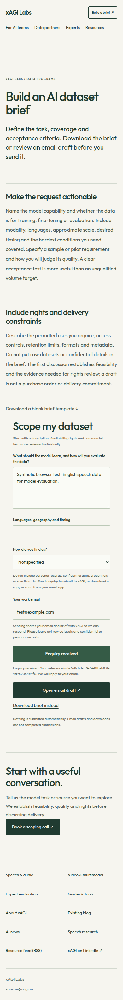

# Enquiry implementation validation — 2026-10-17

Implementation is prepared only. Sending is disabled. No paid upgrade, Worker,
database, production sending secret, or frontend activation variable was created.
The fixed destination address was verified by its owner and confirmed through
the Cloudflare API. Production email delivery has not been tested or claimed.

## Checks completed on AWS

- `npm run lint`: passed with existing unrelated warnings.
- `npm run build`: passed with feature disabled and enabled using a test sitekey.
- `npm run test:enquiry`: all eight tests passed using the actual SQLite schema;
  covers concurrency, replay, altered receipts, uncertain email delivery, lost
  acknowledgement, challenge/origin validation, spam, limits and disabled setup.
- `npm run test:marketing`: passed privacy, storage denial and fallback checks.
- `wrangler deploy --dry-run`: bundle/config validation passed; nothing deployed.
- Mobile browser harness: five routes at 390px, no overflow or React errors;
  invalid submissions blocked, failure retains text without a conversion,
  retry reuses the receipt, success emits one contact-free confirmation event.
- Both exports: all 501 sitemap URLs pass canonical and structured-data checks.
- Regression compares 1,426 HTML files with main `a619a9f`: no missing HTML or
  sitemap URLs. Disabled build has no visible changes. Enabled build changes
  only homepage, dataset brief, partner and expert enquiry pages. The existing
  Opportunities source-check timestamp and pre-existing nondeterministic game
  emoji/date presentation are normalized by the comparison script.
- Ten live routes return HTTP 200, checked from the Mac using curl. Plain Python
  urllib from AWS was blocked with 403 by the existing edge protections; no WAF
  or bot setting was changed. See `live-preservation.json` for actual results.
- Zoho root MX remains mx.zoho.com / mx2.zoho.com / mx3.zoho.com.

The Opportunities prebuild refresh updates its generated JSON snapshot. That
incidental change was excluded and the tracked snapshot restored from HEAD.
Existing Opportunities source/routes are unchanged.

## Test screenshot

This screenshot uses a synthetic email address and mocked challenge/API replies.
It demonstrates the UI, not real sending, inbox delivery or a commercial lead.
No real enquiry data or credentials appear in the committed evidence.

See [activation and rollback runbook](../../workers/enquiry/README.md) for the
remaining account gates and required real email/receipt verification. Certificate
maintenance remains separate. Do not enable public submissions until those
checks pass and the owner approves activation.
